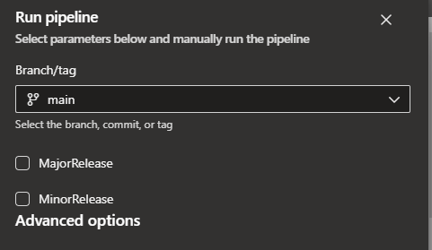

# Depends On

[Design and style the component](Design-and-style-the-component.md)
[Write Storybook story](Write-Storybook-story.md)

# Next Step

[Write Selenium test cases](Write-Storybook-story.md)

# Folder Structure

<pre>
SeleniumTestComponents
└──src
   └──SeleniumTestComponents
      └── Components
          └── <span style="color:#00BFFF">{ComponentName}Manager.cs</span> // Export The Manager 

</pre>

# Introduction

- I strongly recommend writing these test in Visual Studio
- Selenium Tests have proven to be extremely flakey and thus very frustrating to work with. By putting all test logic into a a single class, fixing a flakiness issues fixes it everywhere

# Creating the **Component Manager**

- The component manager is used to access all information on a component and perform all interactions. In general, it should have all of the same functions as the jest tester class

```cs
using OpenQA.Selenium;

namespace SeleniumTestComponents.Components;

public class ChipComponentManager(IWebElement element) : IWrapsElement
{
    // Needed for EVERY component manager
    public IWebElement WrappedElement => element;

    // Example functions
    public string Text => this.WrappedElement.Text;
    public bool IsSelected => this.WrappedElement.GetAttribute("aria-pressed") == "true";
    public void Click() => this.WrappedElement.Click();
}

```

# Publishing SeleniumTestComponents NuGet package

Run [this pipeline](https://dev.azure.com/DesignSystem/DesignSystem/_build?definitionId=650) manually to publish the Nuget package. Select the appropriate Major or Minor release version as shown here.

