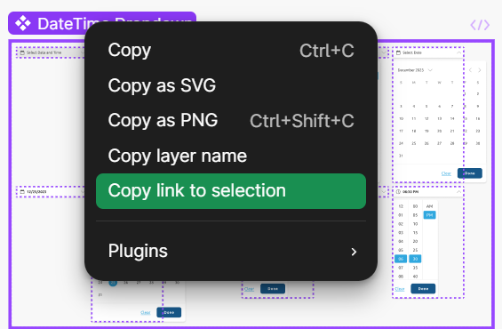

# Depends On

- [Design and style the component](Design-and-style-the-component.md)

# Next Step

- All done!

# Folder Structure

<pre>
design-system-react
└──figma
   └── <span style="color:#00BFFF">{ComponentName}.figma.tsx</span> // Auto generated with figma commands 
</pre>

# Introduction

Figma Code Connect is a powerful tool used to establish a link between the components built in the "[Design System](https://dev.azure.com/DesignSystem/DesignSystem/_git/DesignSystem?path=/%40designsystem)" controlled by the dev team and the "[Figma Design System](https://www.figma.com/design/MkgpIgyPyIYr0oodbPa4cf/DesignSystem?node-id=10001-13717&node-type=canvas&m=dev) " controlled by the design team. For way more details then this page provides, see the [Figma Code Connect - The Comprehensive Guide](https://dev.azure.com/DesignSystem/DesignSystem/_wiki/wikis/DesignSystem.wiki/2634/Figma-Code-Connect-The-Comprehensive-Guide) Wiki page

# React/Cato Certificate compatibility

- Before you doing anything with code connect run [this script](https://dev.azure.com/DesignSystem/DesignSystem/_git/DesignSystem.DesignSystem.Infrastructure.Deploy?path=/DevUtilities/FixNodeSelfSignedCertificate.ps1) anywhere on your PC
- When a DesignSystem developer using the CATO vpn attempts to connect the figma design system via `npx code connect` we get an error exactly as described in this document [https://github.com/figma/code-connect/issues/101](https://github.com/figma/code-connect/issues/101)

  
  

# Figma Code Connect

## Generate a Figma Personal Access Token

- Navigate to the [Figma Design System](https://www.figma.com/design/MkgpIgyPyIYr0oodbPa4cf/DesignSystem?node-id=0-25912&node-type=frame&m=dev)  -> Select the "Figma F" icon in the top left -> `Help and account` -> `Security` -> Scroll down to `Personal access tokens` -> `Generate New Token` -> Name the token -> Set `Code Connect` : `Write` -> `Generate token`

* You will see a token with the form "figd\_{guid}"
* Copy and save it somewhere

## Connect your component

- In the **design-system-react** folder run ...
  - `npx figma connect create "<component_url>" --token <figma_token>` - to get the <component_url> open the design system -> select the name of the component -> copy the url
     - Alternatively you can open the design system -> right click the name of the component -> **copy link to selection**
    

## Modify File

- The previous step will generate a file called "{component_name}.figma.tsx"
- Move this file to the "figma" folder in **design-system-react**
- Figma will generate a file that looks something like this

```ts
figma.connect(
  SolidButton,
  "https://www.figma.com/design/MkgpIgyPyIYr0oodbPa4cf/DesignSystem?node-id=0-25912&m=dev",
  {
    // Props deteremined by the design team
    props: {
      buttonImage: figma.instance("buttonImage"),
      showEndImage: figma.boolean("showEndImage"),
      showStartImage: figma.boolean("showStartImage"),
      state: figma.enum("State", {
        Default: "default",
        "Hover State": "hover-state",
        Progress: "progress",
        Disabled: "disabled",
        Focused: "focused",
      }),
      style: figma.enum("Style", {
        Primary: "primary",
        Secondary: "secondary",
      }),
    },
    // The component you designed
    example: (props) => <SolidButton />,
  }
);
```

- From here you need to match up the figma defined props with the component props, something like ...

```ts
// Fill in all props
example: (props) => (
            <SolidButton
                variant={props.state} // 1:1 Mapping works perfectly
                style={props.style}
            />
        ),
```

# Handling Variants

- The Figma "example" can not run arbitrary JavaScript, therefor if a mapping from a figma prop to component props has anything other than a 1:1 relationship you need to use variants to handle this.

```ts
figma.connect(
  SolidButton,
  "https://www.figma.com/design/MkgpIgyPyIYr0oodbPa4cf/DesignSystem?node-id=0-25912&m=dev",
  {
    props: figmaProps, // Extract out figma props
    variant: { showEndImage: false, showStartImage: true }, // Determine which code block to show in the Figma Playground Code Connect
    example: ({ label, state, style, buttonImage }) => (
      <SolidButton
        buttonText={label}
        variant={state}
        style={style}
        leadingImage={buttonImage as unknown as FC<IconPropsWithoutChildren>}
      />
    ),
  }
);
```


## Publish File

- run `npx figma connect publish --token <figma_token>`
- You can verify that the component published correctly by selecting the component in Figma and clicking "Open in Playground". You should see example code and it should react to changes made in the playground
  
