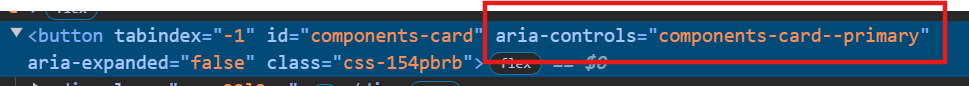
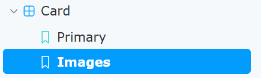
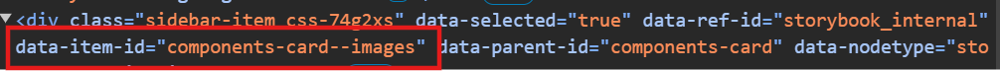

# Depends On

[Implement Selenium Tester class](Implement-Selenium-Tester-class.md)

[Write Storybook story](Write-Storybook-story.md)

# Next Step

[Integrate with Figma Code Connect](Integrate-with-Figma-Code-Connect.md)

# Folder Structure

<pre>
SeleniumTestComponents
└──src
   └──SeleniumTestComponents.Tests
      └── <span style="color:#00BFFF">Tests</span>
          └── <span style="color:#00BFFF">{ComponentName}Test.cs</span> // Tests 
   └──SeleniumTestComponents.Tests
      └── <span style="color:#00BFFF">PageManager</span>
          └── <span style="color:#00BFFF">{ComponentName}Manager.cs</span> // Manage The Actual Tests
</pre>

# Page Manager

- In order to E2E test a Design system, we run an instance of storybook and test against that.
- You need to set up a page manager for each page component

```cs
public class CardPageManager(IWebDriver webDriver, EnvironmentConfig environmentConfig)
    : StorybookBasePageManager(webDriver, environmentConfig) // Every Page manager extends StorybookbasePageManager
{
    public CardComponentManager Card =>
        new(this.Wait.Until(d => d.FindElement(By.CssSelector("[data-testid=designsystem-card]")))); // The data-testid of the component defined in your storybook file
}
```

# SUPER IMPORTANT

- When storybook is running the left menu is the page and the right side (where the components are) is actually an iframe. Therefor, if you attempt to access the component in your C# tests you will get errors saying it can't locate the element. You MUST include `SwitchToStorybookIframeContext()` in your test before you attempt to access any property on the component.
- The **primary-url** is the **aria-controls** you see when you inspect the element in storybook.
  
  
- To select a storybook variant other then the primary component, use **NavigateToComponentVariant()** and pass in the data-item-id of that component

  
  

# Writing the E2E tests

```cs

private readonly Uri primaryUrl = new("components-card--primary", UriKind.Relative);
private readonly string imagesCard = "components-card--images";

[Fact]
public void ShouldShowTitleSubtitleAndSubHeaders() {
    // Arrange
    var cardPageManager = new CardPageManager(webDriver, environmentConfig);
    cardPageManager.NavigateToStorybookPage(this.primaryUrl);
    cardPageManager.NavigateToComponentVariant(this.imagesCard);
    cardPageManager.SwitchToStorybookIframeContext(); // !Super Important!

    // Assert
    Assert.Equal("Title", cardPageManager.Card.Title());
    Assert.Equal("Subtitle", cardPageManager.Card.SubTitle());
    Assert.Equal("Success", cardPageManager.Card.StatusType());
    Assert.True(cardPageManager.Card.IsClickThru());
}
```
